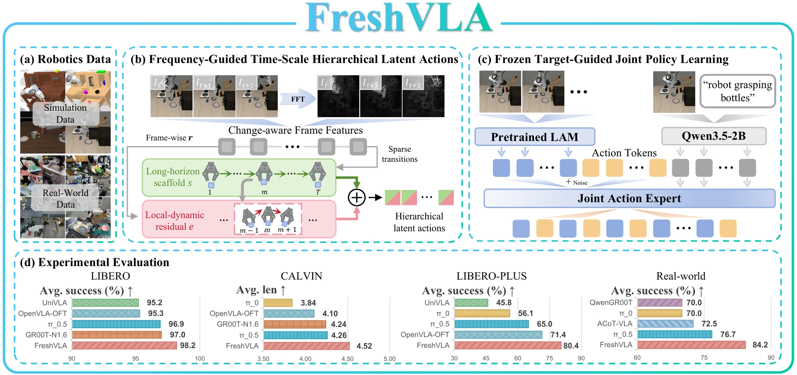

# FreshVLA

### Frequency-Regularized Time Scale Hierarchical Latent Actions for Vision-Language-Action Models

  
  

## Code

Coming soon.

## Method

**Video pretraining.** A temporal high-pass prior guides attention toward regions that change in videos without action labels. FreshVLA encodes slow task progress in one latent stream and the remaining frame-to-frame motion in another.

**Policy training.** The frozen encoder supplies latent action targets for robot demonstrations. A flow-matching policy learns to generate these latent actions and robot commands together, conditioned on the observation, language instruction and robot state.
